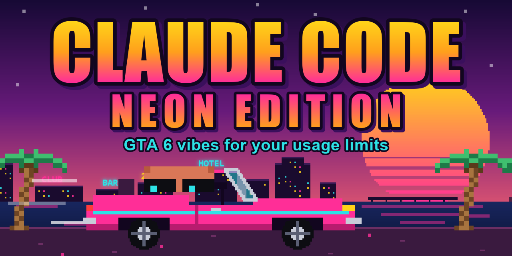
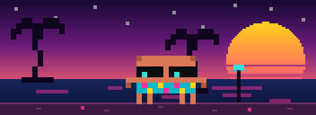

# neon-limity 🌴 GTA 6 vibes for Claude Code



Waiting for GTA 6? Bring the sunset, the neon and the wanted stars into your Claude Code sessions in the meantime.

A GTA 6-inspired neon HUD above the Claude Code prompt: context, cache, 5h and 7-day limits as ring gauges, model and effort badges, session cost, and a pixel-art Claude mascot in a Hawaiian shirt on a synthwave beach.

- The sun sinks as the 5h limit drains; night falls when it runs out.
- Clouds and rain follow the context fill.
- While Claude works the mascot walks in place as the world scrolls past in parallax: a row of palms on the sand, waves, stars, and a city skyline on the horizon (downtown towers, neon clubs, a hotel strip, the pier).
- After 20 seconds on the road Claude hops into a pink convertible and everything speeds up.
- At tools it stops and uses a laptop, a terminal or binoculars depending on the tool. A mini Claude joins when a subagent runs.
- While waiting it takes its shades off and blinks; after 15 idle minutes it naps on a hammock.
- Mission banner with a jingle after a long turn, a cash pickup showing each answer's cost, a police boat at a high wanted level, and a WASTED screen with a police cruiser when a limit runs out.
- Every task becomes a named mission (`MISSION “ADD DARK MODE” in Neon Bay`).
- 📱 Limit warnings arrive as in-game phone texts.
- 🏆 Nine achievements (First Mission, Marathon, Cache Master, Night Owl, Most Wanted, Back from WASTED…) and a `/neon-stats` career screen, kept across sessions.
- `/neon-hud` hides or shows the HUD. The "💬" button under the scene gives a random tip.



## Install

At the prompt of a terminal session:

```
/plugin install neon-limity --marketplace Aloister/neon-limity
```

From a shell:

```
claude plugin install neon-limity --marketplace Aloister/neon-limity
```

In the desktop app, where `/plugin` does not run: click + next to the prompt box, then Plugins, Add marketplace with `Aloister/neon-limity`, then Add plugin.

## Disclaimer

Unofficial fan project. Not affiliated with, endorsed or sponsored by Rockstar Games or Take-Two Interactive. "Grand Theft Auto" and "GTA" are trademarks of Take-Two Interactive Software. All art, sounds and code here are original.
